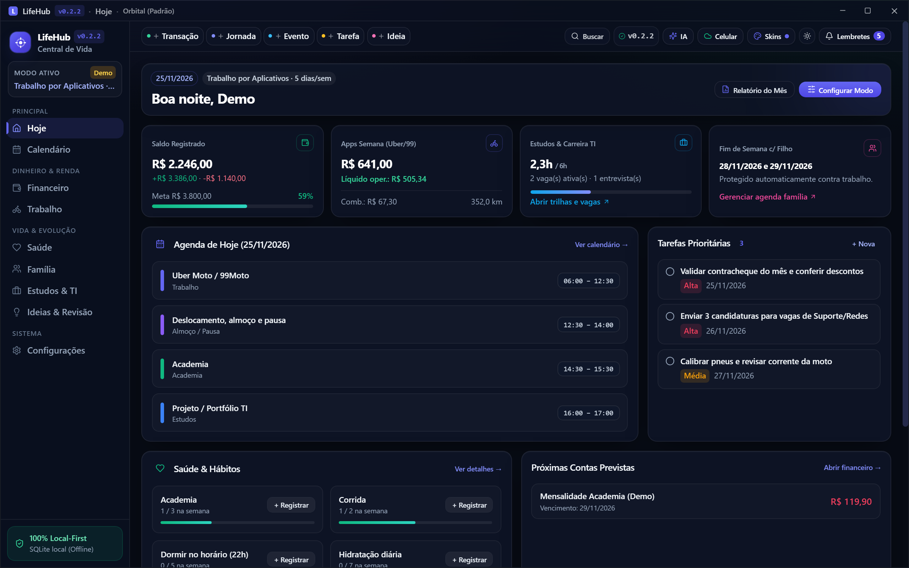
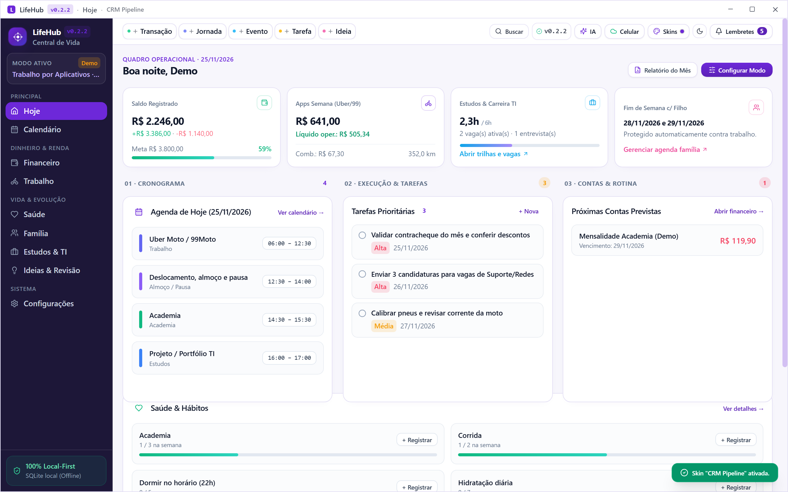
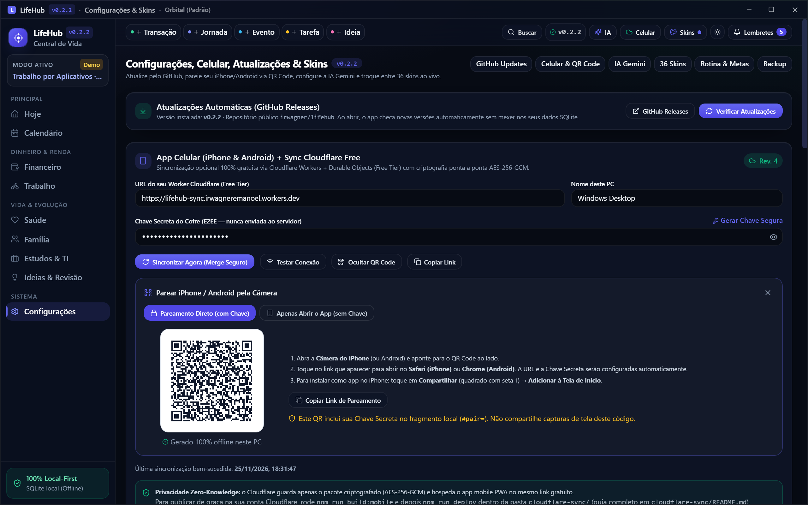
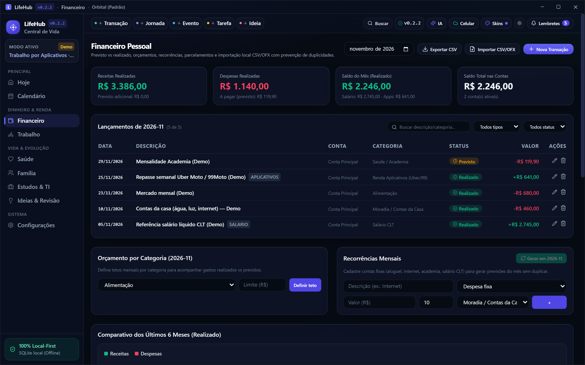
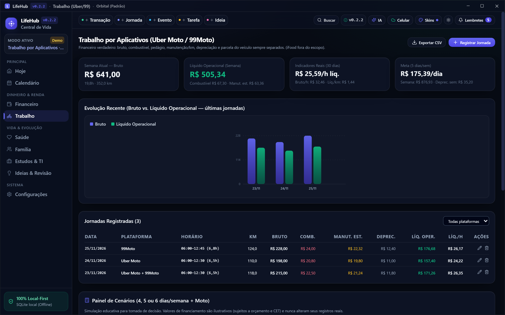
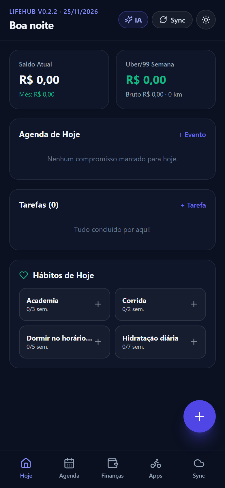

<div align="center">

# LifeHub — Central de Vida

**Seu painel pessoal local-first para Windows, iPhone e Android.**  
Organize finanças reais, trabalho por aplicativos (Uber Moto / 99Moto), agenda, saúde, estudos de TI e família — com **36 skins ao vivo**, **Assistente IA Gemini opcional**, **QR Code offline** e **sincronização criptografada ponta a ponta gratuita**.

[](https://github.com/irwagner/lifehub/releases/latest)
[](https://github.com/irwagner/lifehub/releases/latest)
[](https://lifehub-sync.irwagneremanoel.workers.dev)
[](https://github.com/irwagner/lifehub#-app-celular-iphone--android--qr-code-offline)

<p>
  <a href="https://github.com/irwagner/lifehub/releases/latest"><strong>⬇️ Baixar para Windows (v0.2.10)</strong></a>
  &nbsp;·&nbsp;
  <a href="https://lifehub-sync.irwagneremanoel.workers.dev"><strong>📱 Abrir App Mobile (iPhone / Android)</strong></a>
  &nbsp;·&nbsp;
  <a href="#-tour-visual"><strong>🖼️ Ver Prints</strong></a>
  &nbsp;·&nbsp;
  <a href="#-rodar-em-desenvolvimento"><strong>🛠️ Rodar Localmente</strong></a>
</p>

<br />



</div>

---

## ⬇️ Baixar e Usar em 1 Clique (Windows)

Acesse a [**Última Release no GitHub**](https://github.com/irwagner/lifehub/releases/latest) e escolha sua opção:

| Arquivo | Tamanho | Ideal para |
| :--- | :---: | :--- |
| **[`LifeHub.exe`](https://github.com/irwagner/lifehub/releases/latest/download/LifeHub.exe)** *(Portátil)* | ~12 MB | **Duplo clique e pronto** — sem instalador, CRT estático (`+crt-static`) e atualização automática em 1 clique pelo próprio app. |
| **[`LifeHub-Instalador-Windows.exe`](https://github.com/irwagner/lifehub/releases/latest/download/LifeHub-Instalador-Windows.exe)** *(NSIS)* | ~3,4 MB | Instala com atalho na Área de Trabalho e Menu Iniciar (e baixa o WebView2 automaticamente se faltar no Windows 10). |

> **Atualização automática integrada:** ao abrir, o LifeHub verifica novas releases em `irwagner/lifehub`, exibe o botão verde **`Atualizar vX.Y.Z`** na barra superior e substitui o binário preservando 100% do seu banco SQLite local.

---

## 🖼️ Tour Visual

### Troca de Visual e Arquitetura ao Vivo (**36 Skins**)
Altere não apenas as cores, mas toda a **estrutura de janela, barra de navegação e layout do dashboard** em tempo real — do dark minimalista (*Orbital*) ao quadro operacional claro (*CRM Pipeline*, *Editorial*, *macOS Dots*, *Retro 98* e mais).

<table>
  <tr>
    <td width="50%">
      
      <p align="center"><sub><strong>Skin CRM Pipeline (Clara)</strong> — Sidebar dual-tone + quadro Kanban em 3 colunas</sub></p>
    </td>
    <td width="50%">
      
      <p align="center"><sub><strong>Configurações</strong> — Auto-Update pelo GitHub + QR Code 100% offline para iPhone/Android</sub></p>
    </td>
  </tr>
  <tr>
    <td width="50%">
      
      <p align="center"><sub><strong>Financeiro Pessoal</strong> — Previsto vs. realizado, orçamentos, recorrências e CSV/OFX</sub></p>
    </td>
    <td width="50%">
      
      <p align="center"><sub><strong>Uber Moto & 99Moto</strong> — Bruto vs. líquido real por hora/km, combustível e depreciação</sub></p>
    </td>
  </tr>
</table>

### 📱 App Celular (iPhone & Android) — PWA Gratuito

<table>
  <tr>
    <td width="300" align="center">
      
    </td>
    <td valign="top">
      <h3>Pareamento em segundos pela Câmera</h3>
      <ol>
        <li>No <strong>LifeHub do Windows</strong>, abra <strong>Configurações → App Celular &amp; QR Code</strong>.</li>
        <li>Gere sua <strong>Chave Secreta</strong> (E2EE) e clique em <strong>Sincronizar Agora</strong>.</li>
        <li>Aponte a <strong>Câmera do iPhone ou Android</strong> para o <strong>QR Code gerado offline</strong> na tela.</li>
        <li>No <strong>Safari (iPhone)</strong>, toque em <strong>Compartilhar ↑ → Adicionar à Tela de Início</strong> para usar em tela cheia como aplicativo nativo.</li>
      </ol>
      <p>
        <strong>Zero-Knowledge real:</strong> seus dados são criptografados com <code>PBKDF2-SHA256</code> + <code>AES-256-GCM</code> antes de sair do dispositivo. O servidor na Cloudflare (<em>Workers + Durable Objects Free Tier</em>) nunca recebe nem consegue ler sua Chave Secreta.
      </p>
      <p>
        🔗 <strong>Link direto do PWA:</strong> <a href="https://lifehub-sync.irwagneremanoel.workers.dev"><code>lifehub-sync.irwagneremanoel.workers.dev</code></a>
      </p>
    </td>
  </tr>
</table>

---

## ✨ Principais Recursos

- **100% Local-First & Privado**: banco SQLite nativo no Windows (`lifehub.db`) e SQLite WebAssembly offline no navegador/celular. Na primeira abertura, começa limpo (com botão opcional para testar **Dados de Demonstração**).
- **36 Skins & 6 Arquiteturas de Janela**: alternância instantânea no topo da tela sem perder dados.
- **Assistente IA Gemini (Opt-in · `Alt+A`)**:
  - Usa sua própria chave do Google AI Studio (salva apenas localmente).
  - Prioridade inteligente **dos melhores modelos para os reservas** (`Gemini 4 Hydrogen → 3.8 Flash → 3.6 Flash → 3.5 Flash Lite → 3.1 Flash Lite → Gemma 4 31B`) com fallback automático em caso de limite de cota (`429`).
  - Entende linguagem natural do dia a dia (ex.: *"ganhei 1200 da primeira parcela hoje"*, *"rodei 85 km na Uber Moto, fiz 190 bruto e 32 de gasolina"*) e lança direto no Financeiro, Agenda ou Tarefas.
  - Controle de privacidade para ocultar valores em `R$` ou alternar entre salvamento direto e confirmação manual.
- **Financeiro Verdadeiro**: receitas, despesas, transferências, parcelamentos com precisão de centavos, orçamentos por categoria, recorrências idempotentes, importação **CSV/OFX** anti-duplicidade, exportação CSV e Relatório Mensal em Markdown/PDF.
- **Trabalho por Aplicativos (Uber Moto / 99Moto)**: separa faturamento bruto, combustível, pedágio, manutenção estimada/km, depreciação e parcela da moto, com odômetro automático e simulador de cenários (4, 5 ou 6 dias/semana).
- **Calendário, Saúde, Família & Estudos TI**: FullCalendar em `pt-BR`, proteção automática de **fins de semana com o filho** (todos, quinzenal com data âncora ou manual), hábitos não-punitivos, cronômetro de estudos de TI, portfólio, vagas e Kanban de ideias.
- **Produtividade por Teclado**: busca global (`Ctrl+K`), Assistente IA (`Alt+A`) e lançamentos rápidos (`Alt+T`, `Alt+J`, `Alt+C`, `Alt+K`, `Alt+I`).

---

## 🧱 Stack & Arquitetura

| Camada | Tecnologias |
| :--- | :--- |
| **Desktop Windows** | Tauri 2 (Rust), WebView2, `tauri-plugin-sql` (SQLite nativo), Auto-Updater via GitHub Releases |
| **Frontend & Mobile PWA** | React 18, TypeScript, Vite 6, Tailwind CSS, FullCalendar, `sql.js` (SQLite WASM), `uqr` (QR offline), Zod |
| **Sync Opcional (Grátis)** | Cloudflare Workers + Durable Objects SQLite (Free Tier) + Web Crypto (`PBKDF2-SHA256` / `AES-256-GCM`) |
| **Testes & CI/CD** | Vitest (53 testes de unidade/integração), Rust `cargo test` (5 testes nativos), GitHub Actions Windows Release |

```text
├── src/                  # React + TypeScript (UI, 36 skins, repositórios SQLite, IA Gemini, Sync E2EE)
├── src/mobile/           # App Mobile PWA (iPhone & Android)
├── src-tauri/            # Backend nativo Rust (Tauri 2, SQLite, auto-updater Windows)
├── cloudflare-sync/      # Worker Cloudflare Free Tier (cofre criptografado + hospedagem do PWA)
└── .github/workflows/    # Build & publicação automática de Releases Windows ao criar tag v*
```

---

## 🛠️ Rodar em Desenvolvimento

### Pré-requisitos
- **Node.js 20+** e **`pnpm`**
- **Rust (`rustup` / `cargo`)** e **Visual Studio Build Tools (C++)** *(somente para compilar o executável desktop Tauri)*

### Comandos

```powershell
# 1. Instalar dependências
pnpm install

# 2. Validar tipos e rodar toda a suíte de testes (Vitest + Rust)
pnpm run typecheck
pnpm run test
cargo test --manifest-path src-tauri/Cargo.toml

# 3. Rodar no navegador (Desktop ou Mobile PWA)
pnpm run dev          # Desktop web em http://localhost:1420
pnpm run dev:mobile   # Mobile PWA em http://localhost:5174

# 4. Rodar ou compilar o aplicativo desktop nativo para Windows
pnpm run tauri:dev
pnpm run tauri:build
```

---

<div align="center">
  <sub>Feito com foco em privacidade, velocidade e utilidade real no dia a dia.</sub>
</div>
